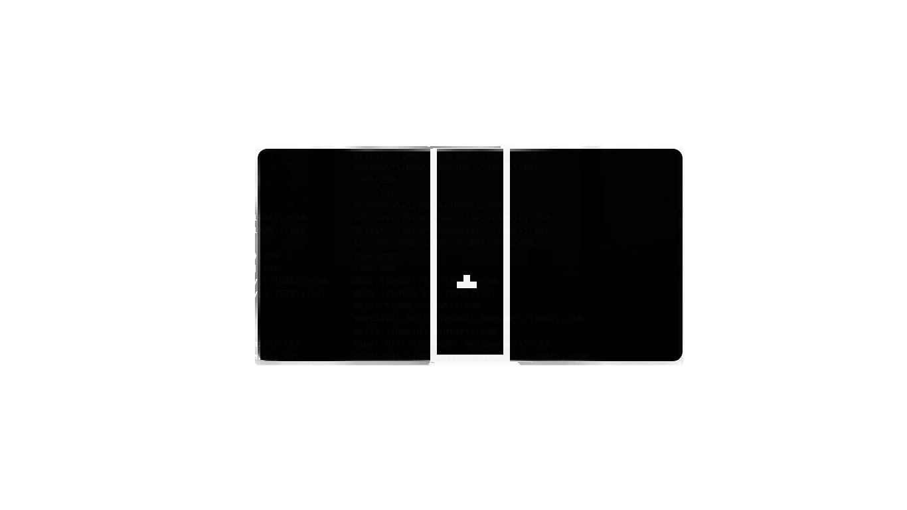
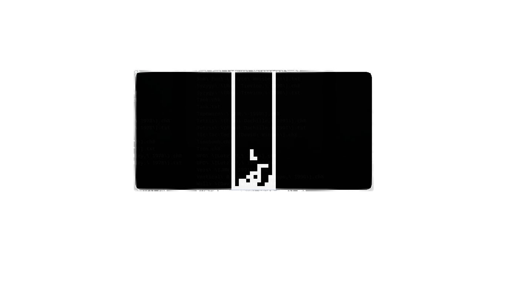

# CHIP-8 Emulator

A simple CHIP-8 emulator written in C using SDL2.  
The name **TSHIP-8** in the code is just a joke; this is a CHIP-8 emulator.

## Features

- Full CHIP-8 CPU core (fetch / decode / execute)
- 64x32 monochrome display, 10x pixel scale
- 16-key QWERTY-mapped keypad
- Delay timer at 60 Hz
- Sound timer with real 440 Hz square-wave audio output via SDL2
- Font sprites (0-F) loaded at `0x000`
- Simple ROM loading from the command line

## Requirements

- GCC or a compatible C compiler
- Make
- SDL2 development libraries

Install SDL2:

### Debian / Ubuntu
```sh
sudo apt install build-essential libsdl2-dev
```

### Arch Linux
```sh
sudo pacman -S base-devel sdl2
```

### Fedora
```sh
sudo dnf install gcc make SDL2-devel
```

### macOS
```sh
brew install sdl2
```

### Windows
Use MSYS2 / MinGW and install the SDL2 development package.

## Build

```sh
make all
```

This creates:

```sh
build/emu
```

## Clean

```sh
make clean
```

## Run

```sh
./build/emu path/to/rom.ch8
```

Example:

```sh
./build/emu roms/Pong.ch8
```

## Controls

```text
CHIP-8 keypad      Keyboard
1 2 3 C            1 2 3 4
4 5 6 D            Q W E R
7 8 9 E            A S D F
A 0 B F            Z X C V
```

## Screenshots




## ROMs

- https://github.com/kripod/chip8-roms
- https://github.com/JohnEarnest/chip8Archive
- https://www.zophar.net/chip8
- https://chip-8.github.io/links/

Please only use ROMs you have the right to use, such as homebrew, public domain, or freely redistributable ROMs.

## Notes

- Screen size: 64x32
- Window size: 640x320
- Pixel scale: 10x
- Target speed: 60 FPS
- Cycles per frame: 10
- Timers tick at 60 Hz

## LICENSE

- This project is under MIT license.
